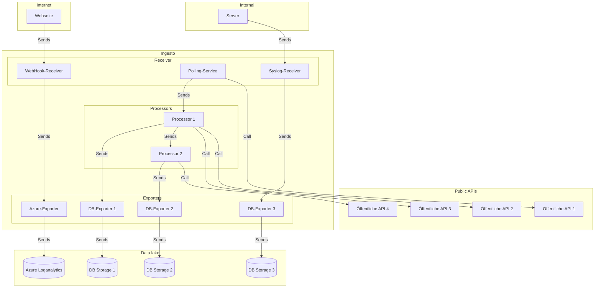

# Ingesto

Ingesto is a simple but fully and heavily configurable data pipeline kind of log routing.

## Components

1. A **receiver** is started to eiter listen or fetch data
2. A **parser** is converting the data into a structured format
3. A **processor** can enrich the structured data with data from other sources
4. An **exporter** is sending the structured data to any kind of storage

### Receivers

A receiver is polling or listening for data and converts it to a structured format.

The structured data is afterwards sent to an exporter or an OpenTelemetry Log Receiver.

* The [**Database-Receiver**](/doc/receiver-database.md) reads data from a database.
* The [**File-Receiver**](/doc/receiver-file.md) either reads a whole file or listens for changes.
* The [**Network-Receiver**](/doc/receiver-network.md) opens either a UPD or a TCP Socket and listens for data.
* The [**Polling-Receiver**](/doc/receiver-polling.md) calls an HTTP-Endpoint, including paging and templating parameters for more dynamic requests.
* The [**Webhook-Receiver**](/doc/receiver-webhook.md) listens as an HTTP-Endpoint and parses the received data.

### Processors

Processors receive OpenTelemetry Logs, enrich or transform each message and send the result as an OpenTelemetry Log to the next receiver or exporter.

* The [**Polling-Processor**](doc/processor-polling.md) calls an HTTP-Endpoint for each received message, using values of the message in the request, and forwards the answer.

### Exporters

Exporters receive OpenTelemetry Logs and try to process the contained data to store it in a specific format.

The log format must be structured JSON so different fields and values can be set in a expected storage like a database, key-value store or any other log storage format.

* The [**Database-Exporter**](doc/exporter-database.md) saves data in a PostgreSQL, Maria/MySQL or SqLite Database.
* The [**AzureDCR-Exporter**](doc/exporter-azuredcr.md) sends data to an Azure DCR (Data Collection Rule).

### Example




## Build and Run

Build is either done like standard rust applications or via container environment:

```bash
$ cargo build -r
...
   Compiling ingesto-webhook-listener v0.1.0 (/home/lukas/Documents/projects/ingesto/receiver/webhook)
   Compiling ingesto-network-listener v0.1.0 (/home/lukas/Documents/projects/ingesto/receiver/network)
   Compiling ingesto-database-reader v0.1.0 (/home/lukas/Documents/projects/ingesto/receiver/database)
   Compiling ingesto-azuredcr-exporter v0.1.0 (/home/lukas/Documents/projects/ingesto/exporter/azuredcr)
   Compiling ingesto-file-reader v0.1.0 (/home/lukas/Documents/projects/ingesto/receiver/file)
   Compiling ingesto-network-polling v0.1.0 (/home/lukas/Documents/projects/ingesto/receiver/polling)
   Compiling ingesto-database-exporter v0.1.0 (/home/lukas/Documents/projects/ingesto/exporter/exportdb)

$ podman build -t ingesto:latest -f Containerfile
...
[5/5] STEP 20/22: USER 1000
--> 558add0ca701
[5/5] STEP 21/22: ENTRYPOINT [""]
--> 546c00127993
[5/5] STEP 22/22: CMD [""]
[5/5] COMMIT ingesto:latest
--> e432f10cb91f
Successfully tagged localhost/ingesto:latest
```

Each binary has only one parameter and is used the same way.
For example to start a `network listener`, run this command - given there is a valid configuration:

```bash
$ target/release/ingesto-network-listener -c configs/network-listener.config.toml
```

The container build contains all ingesto binaries and only the needed system libraries and binaries (`sh, ls, cat, rm, mv`) to run ingesto and connect to the container.
It contains two `VOLUME`'s, one for the configuration (`/app/config`) and one for the secrets (`/app/secrets`).
There are no `PORT`'s exposed becuase these are individual and defined in the configuration file, so bind them manually with `-p PORT:PORT`.
The Container runs as `UID 1000` and has no `ENTRYPOINT` and no `CMD`.

To start the same `network listener` as above, run it like this:
```bash
$ podman run --network host -d -p 1514:1514 -v ./secrets:/app/secrets -v ./configs:/app/config localhost/ingesto:latest /app/ingesto-network-listener -c config/network-listener.config.toml
```

To build a custom container only for the above `network listener`, use a `Containerfile.network-listener` like this:
```Dockerfile
FROM localhost/ingesto:latest
RUN mv ingesto-network-listener server && \
    rm ingesto-*
ENTRYPOINT ["/app/server", "-c"]
CMD ["config/config.toml]
```

Build and start it:
```bash
$ podman build -t ingesto-network-listener:latest -f Containerfile.network-listener
...
$ podman run --network host -d -p 1514:1514 -v ./secrets:/app/secrets -v ./configs:/app/config localhost/ingesto-network-listener:latest
$ podman run --network host -d -p 1514:1514 -v ./secrets:/app/secrets -v ./configs:/app/config localhost/ingesto-network-listener:latest config/second-listener.toml
```


